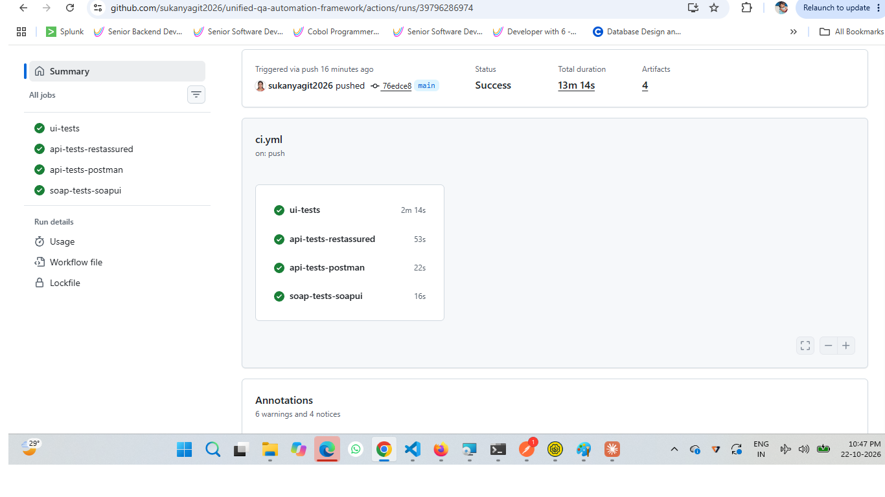

# Unified QA Automation Framework

One repository that tests the same two systems from several angles: UI, REST API and SOAP, with results stored in a database and everything run automatically in CI.

**Systems under test**
- [Restful-Booker Platform](https://automationintesting.online): a hotel booking site with a UI and a REST API
- [Calculator SOAP service](http://www.dneonline.com/calculator.asmx): a public SOAP web service



## What is covered

| Area | Tool | What it tests | Size |
|---|---|---|---|
| UI | Playwright (Python, pytest) | Home page, contact form, admin login, room booking with validation rules | 24 tests |
| UI cross-browser | Selenium (Python, pytest) | Smoke tests on Chrome and Firefox | 3 tests x 2 browsers |
| REST API | Postman + Newman | Rooms, auth, booking create/read/delete | 10 requests, 21 checks |
| REST API | REST Assured (Java, JUnit 5) | Rooms, auth, booking | 6 tests |
| SOAP | SoapUI | Add, Subtract, Multiply, Divide, divide-by-zero SOAP fault | 5 test cases, 17 assertions |
| Results | PostgreSQL | Every UI test result is saved and analysed with SQL | 3 queries |
| Process | JIRA, GitHub Actions | Scrum board with epic, stories and bugs; 4 CI jobs | |

## Project structure

```
ui_playwright/     Playwright page objects and tests
ui_selenium/       Selenium cross-browser smoke tests
api_postman/       Postman collection (run with Newman)
api_restassured/   REST Assured tests (Maven)
soap_soapui/       SoapUI project
db/                schema.sql and queries.sql for results
conftest.py        pytest hooks that save results to PostgreSQL
pytest.ini         pytest settings (retries, paths)
.github/workflows/ci.yml   CI pipeline
```

## Run it locally

**UI tests (Playwright and Selenium)**
```
python -m venv venv
venv\Scripts\Activate.ps1
python -m pip install -r requirements.txt
playwright install chromium
pytest
```
Add `--headed` to watch Playwright run. Set `HEADLESS=1` to run Selenium without a browser window.

**Save results to PostgreSQL (optional; tests still run without it)**
```
docker run --name qa-postgres -e POSTGRES_PASSWORD=qa_pass -e POSTGRES_DB=qa_results -p 5433:5432 -d postgres:16
psql -h localhost -p 5433 -U postgres -d qa_results -f db/schema.sql
pytest
psql -h localhost -p 5433 -U postgres -d qa_results -f db/queries.sql
```

**REST Assured**
```
cd api_restassured
mvn test
```

**Postman collection**
```
newman run api_postman/restful-booker.postman_collection.json --env-var "baseUrl=https://automationintesting.online"
```

**SoapUI**: open `soap_soapui/Calculator-soapui-project.xml` in SoapUI 5.10 and run the "Calculator Tests" suite, or use `testrunner.sh` from the command line.

## Continuous integration

Every push to `main` runs four jobs in GitHub Actions:

1. **ui-tests**: Playwright and Selenium against a PostgreSQL service container; saves results, prints the SQL analysis and uploads an HTML report
2. **api-tests-restassured**: Maven test run, uploads Surefire reports
3. **api-tests-postman**: Newman run, uploads an HTML report
4. **soap-tests-soapui**: SoapUI command-line run, uploads reports

## Notes

- **Shared demo site.** The site under test is a public site used by many people, so occasional slowness is expected. UI tests retry failures twice (`pytest-rerunfailures`), and retries are recorded in the results database so flaky tests are visible with a SQL query.
- **A defect that was fixed.** My API tests found that `GET /api/room/{id}` returned HTTP 500 for every room. It was logged in JIRA (UQAF-8), and the tests documented it as a known defect. When the site's owners fixed it, the CI run caught the change; I then updated the tests to expect HTTP 200.
- **A defect that remains.** Looking up a room that does not exist returns 500 instead of 404. The Postman check documents this.
- **Scope.** The results database stores UI test results (Playwright and Selenium). API and SOAP results are reported by their own tools.